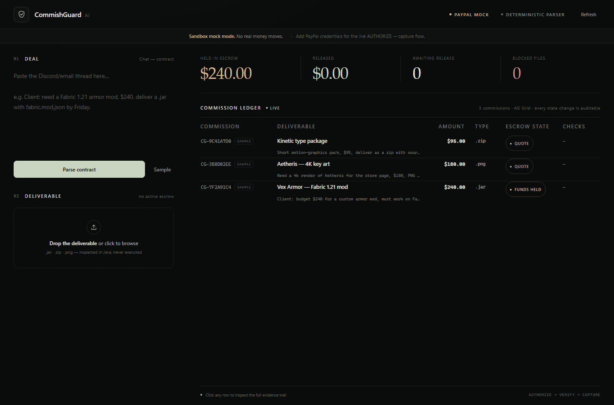
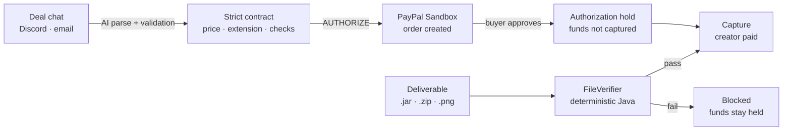
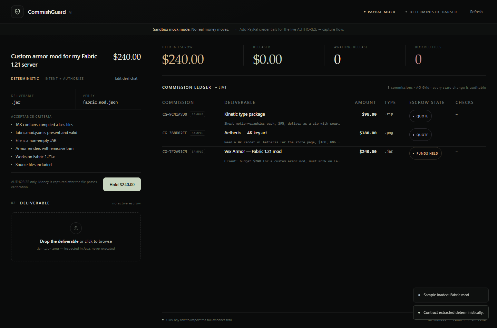
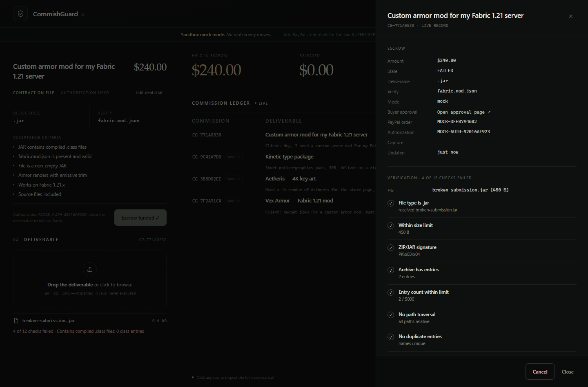
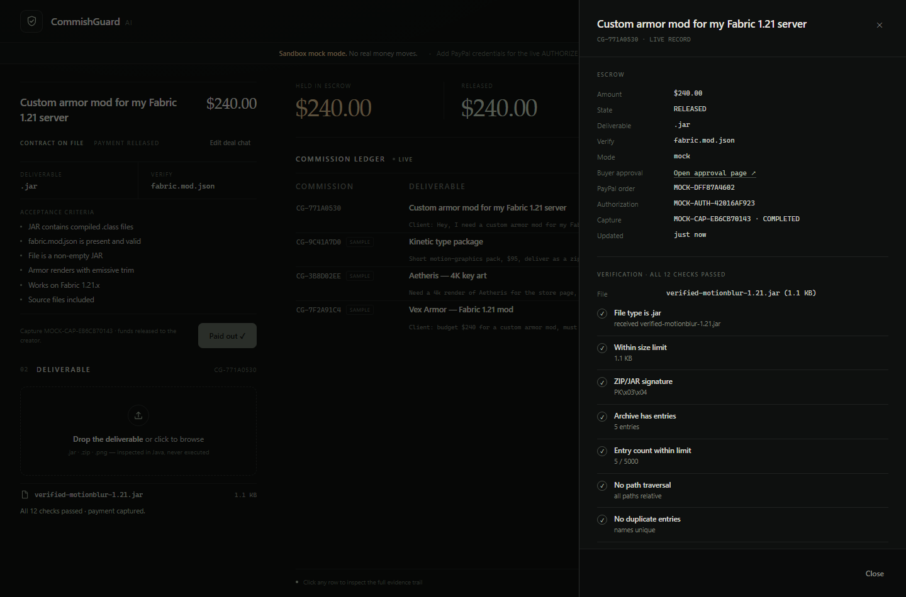

# CommishGuard AI

**Escrow that checks the work before it pays.**

Clients and creators negotiate commissions in messy Discord threads and emails. CommishGuard AI turns that thread into a strict, machine-checkable contract, holds the client's money in a **PayPal Sandbox authorization**, inspects the creator's actual deliverable with deterministic Java, and captures the payment only when the file passes.

> **AI is for ambiguity. Code is for truth.**  
> The LLM reads the chat. Java decides whether the `.jar` is real.



---

## Why this exists

Digital commissions run on trust and screenshots:

- The client pays first and hopes the file arrives.
- The creator delivers first and hopes the client pays.
- "It's a 4K PNG" is usually a claim, not a fact.
- Chargebacks and "the file was broken" disputes have no shared evidence.

CommishGuard makes the deal itself executable. The price, file type, resolution, and required entries are agreed up front, the money is held (not captured), and the release decision is made by code that can be audited line by line.

---

## How it works



1. **Paste the deal chat.** The parser extracts a contract and the server re-validates every field.
2. **Hold the money.** The server creates a PayPal order with `intent=AUTHORIZE`. The buyer approves; funds are authorized, not captured.
3. **Upload the deliverable.** `.jar`, `.zip`, or `.png` is inspected in a quarantine directory. It is never executed.
4. **Release or block.** A passing verification triggers capture automatically. A failing one keeps the money held and shows every failed check.

A ledger persisted to `storage/ledger.json` records each state change and provides the AG Grid dashboard.

### See it

| Contract | Blocked | Paid |
|:---:|:---:|:---:|
|  |  |  |
| Terms extracted and validated | Missing classes stopped before money moves | Every check and PayPal event retained |

## Judge quick start — 3 steps

**Prerequisite: JDK 21.** The Gradle wrapper downloads the correct Gradle version. AG Grid loads from jsDelivr, so first paint needs network access.

### 1. Run it

```bash
cp .env.example .env      # optional — everything works without it
./gradlew run --console=plain
```

Windows PowerShell:

```powershell
Copy-Item .env.example .env
.\gradlew.bat run --console=plain
```

Open **http://localhost:7070**.

### 2. Pick a mode

**Zero-config mock — default.** Leave `.env` empty. `PAYPAL_MOCK` auto-enables, the deterministic parser runs, no AI call is made, and no real money moves. The top bar shows a quiet `PAYPAL MOCK` label.

**Live Sandbox + LLM.** Add the three keys and restart:

```bash
PAYPAL_CLIENT_ID=...
PAYPAL_CLIENT_SECRET=...
AI_API_KEY=...
```

The app now uses `Environment.SANDBOX` and the live LLM parser. The top bar changes to a muted **SANDBOX LIVE** pill, and the parser badge shows the model name. `LLM_API_KEY` remains accepted as an alias for `AI_API_KEY`; `PAYPAL_MOCK=true` still forces mock mode.

### 3. Run the demo

1. Click **Sample** → **Parse contract** → **Hold funds** → **Fund escrow ↗**.
2. In mock mode, approve on the local mock checkout. In live mode, sign in with a PayPal Sandbox personal account.
3. Drag `demo-assets/broken-submission.jar` onto the dropzone. It is blocked; open the row to see exactly which checks failed.
4. Drag `demo-assets/verified-motionblur-1.21.jar`. All checks pass, capture fires automatically, and the row becomes **Paid out**.

Regenerate the payloads at any time with `./gradlew generateDemoAssets`. The seeded ledger ships with three clearly labelled `SAMPLE` rows so the dashboard is never empty on first paint. They are not real transactions.

Use **Edit deal chat** on the contract card to bring the original thread back at any time. `demo/aetheris-1920.png` and `demo/fake.png` still exercise the image checks.

---

## PayPal integration

Implemented with the official **PayPal Server SDK** (`com.paypal.sdk:paypal-server-sdk:0.6.1`), not hand-rolled REST.

| Step | SDK call | Result |
|---|---|---|
| Create order | `OrdersController.ordersCreate` with `CheckoutPaymentIntent.AUTHORIZE` | Order id + buyer approval link |
| Buyer approves | PayPal-hosted checkout, return to `/api/paypal/return` | Order `APPROVED` |
| Place hold | `OrdersController.ordersAuthorize` | Authorization id; funds held |
| Release | `PaymentsController.authorizationsCapture` | Capture id; payment taken |
| Fallback | `OrdersController.ordersCapture` | Used only if order-level capture is required |
| Cancel | `PaymentsController.authorizationsVoid` | Hold released where possible |

Guardrails:

- `Environment.SANDBOX` is forced. Live credentials are never used by this build.
- Order creation sends a `PayPal-Request-Id` idempotency header derived from the commission.
- The return endpoint calls `ordersAuthorize` and persists the authorization id; refreshing it reuses the hold instead of creating a second one.
- Capture sends `final_capture=true`, closing the authorization rather than leaving it open.
- Amounts are normalized to 2 decimals in USD; the amount captured is the validated contract amount, never a client-supplied value.
- Client id/secret stay server-side. The browser only receives the approval URL.
- Mock mode returns `MOCK-…` ids and a local checkout page so the flow is fully demoable offline.

Relevant code: [`PayPalService.java`](src/main/java/com/commishguard/service/PayPalService.java).

### Live Sandbox test

```bash
# .env
PAYPAL_CLIENT_ID=...
PAYPAL_CLIENT_SECRET=...
AI_API_KEY=...            # optional: enables the live parser
```

```bash
./gradlew paypalSmoke --console=plain
```

The task prints the Sandbox order id and approval URL, or skips cleanly when credentials are absent. On restart, the top bar switches from `PayPal mock` to the outlined `Sandbox Live` pill.

---

## AI contract parsing

`AiContractService` calls any OpenAI-compatible chat-completions endpoint using Java 21 `HttpClient`.

- System prompt locks the output to **JSON only** and defines the exact schema.
- Temperature `0.1`; `response_format: json_object` is requested where supported.
- Fenced JSON and surrounding prose are stripped defensively.
- The result is **always re-validated server-side**: price range, extension whitelist, checklist size, title length.
- Chat text is treated as untrusted data, never as model instructions. A model that emits extra fields cannot widen the contract.
- `AI_API_KEY` enables the live parser (`LLM_API_KEY` is accepted as an alias); the endpoint, model, and timeout are configurable.
- If no key is configured — or the call fails — a deterministic regex parser handles `$240`, `240 USD`, `.jar`, `4k`, `1920x1080`, `1080p`, and entry names such as `fabric.mod.json`.

Contract shape:

```json
{
  "title": "Vex Armor — Fabric 1.21 mod",
  "priceUSD": 240.00,
  "requiredExtension": ".jar",
  "minResolutionOrEntryCheck": "fabric.mod.json",
  "checklist": [
    "Fabric mod loads on 1.21.x",
    "Custom armor renders with emissive trim",
    "Source files included"
  ]
}
```

Relevant code: [`AiContractService.java`](src/main/java/com/commishguard/service/AiContractService.java).

---

## Deterministic verification

`FileVerifier` trusts bytes, never filenames or `Content-Type`.

| Check | `.jar` / `.zip` | `.png` |
|---|---|---|
| Extension matches contract | ✓ | ✓ |
| Magic bytes / real container | ZIP `PK` signature | `89 50 4E 47` signature |
| Non-empty, under size limit | ✓ | ✓ |
| Parses as valid archive / image | `ZipInputStream` walk | `ImageIO.read` non-null |
| Required content | ≥1 compiled `.class` with `CAFEBABE`; `fabric.mod.json` when required; manifest warns only | Width/height meet agreed minimum |
| Anti-fake | duplicate entry detection | rejects blank / single-color canvases |
| Abuse limits | max 5,000 entries, 250 MB uncompressed, 200:1 ratio | min 400 rendered pixels |
| Path safety | rejects `..`, absolute paths, backslash traversal | — |

Every check returns a label, pass/fail, and a human-readable reason shown in the drawer. Uploads land in `storage/uploads/<commission>/` with a UUID filename; the original name is display-only.

Relevant code: [`FileVerifier.java`](src/main/java/com/commishguard/service/FileVerifier.java).

---

## API

| Method | Path | Purpose |
|---|---|---|
| `GET` | `/api/health` | Version, PayPal mode, parser mode, uptime |
| `POST` | `/api/contracts/parse` | `{chat}` → `{contract, source, warnings}` |
| `GET` | `/api/commissions` | Ledger rows + aggregate stats |
| `POST` | `/api/commissions` | `{chat, contract}` → create order and hold |
| `GET` | `/api/commissions/{id}` | One commission with evidence |
| `POST` | `/api/commissions/{id}/deliverable` | Multipart `file` → verify → auto-capture |
| `POST` | `/api/commissions/{id}/release` | Manual capture, verified rows only |
| `POST` | `/api/commissions/{id}/cancel` | Void authorization / cancel commission |
| `GET` | `/api/paypal/return` | Buyer approval return URL |
| `GET` | `/api/paypal/cancel` | Buyer cancellation return URL |
| `GET` | `/api/paypal/mock-checkout` | Mock approval page (mock mode only) |
| `GET` | `/api/paypal/mock-approve` | Finish mock authorization |

Errors use a stable shape: `{"error": "...", "code": "..."}`. Secret values and raw stack traces never reach the browser.

---

## Configuration

Copy `.env.example` to `.env`; it is git-ignored.

| Variable | Default | Notes |
|---|---|---|
| `PORT` | `7070` | HTTP port |
| `PAYPAL_CLIENT_ID` / `PAYPAL_CLIENT_SECRET` | — | Sandbox app credentials only |
| `PAYPAL_MOCK` | auto | `true` forces mock; absent credentials auto-enable mock |
| `PAYPAL_RETURN_URL` / `PAYPAL_CANCEL_URL` | localhost URLs | Must match the Sandbox app settings |
| `AI_API_KEY` | — | Enables the AI parser; preferred name. `LLM_API_KEY` is an alias |
| `LLM_BASE_URL` | `https://api.openai.com/v1` | Any OpenAI-compatible endpoint |
| `LLM_MODEL` | `gpt-4o-mini` | Model id |
| `LLM_TIMEOUT_SECONDS` | `20` | HTTP timeout |
| `FILE_MAX_MB` | `50` | Per-upload limit |
| `STORAGE_DIR` | `storage` | Ledger + quarantine directory |
| `VERIFY_MAX_ENTRIES` | `5000` | Zip entry cap |
| `VERIFY_MAX_UNCOMPRESSED_MB` | `250` | Zip-bomb guard |
| `VERIFY_MAX_RATIO` | `200` | Compression-ratio cap |
| `VERIFY_MIN_RENDER_PIXELS` | `400` | Blank-image guard |

---

## Build and test

```bash
./gradlew test --console=plain       # unit + integration tests
./gradlew build --console=plain      # tests + distribution
./gradlew installDist                # runnable build/install/commishguard/
./gradlew generateDemoAssets         # rebuild the two video payloads
```

Coverage includes contract validation, fallback parsing, fenced/invalid LLM output, PNG/JAR acceptance and rejection, zip-slip and zip-bomb defenses, mock PayPal lifecycle, live Sandbox mode selection, and a sandbox smoke task.

---

## Project map

```
src/main/java/com/commishguard/
├── App.java                    Javalin bootstrap, port 7070
├── config/EnvConfig.java       typed env + .env loading
├── model/                      Contract, Commission, VerificationResult, audit events
├── service/
│   ├── AiContractService.java  LLM call + deterministic fallback + validation
│   ├── PayPalService.java      Sandbox AUTHORIZE → authorize → capture, mock mode
│   ├── FileVerifier.java       archive / image inspection
│   └── LedgerService.java      state machine + atomic JSON persistence
└── web/Api.java                routes, multipart, error mapping

src/main/resources/public/index.html   single-page studio + AG Grid ledger
docs/                                  screenshots used in this README
demo-assets/                           reproducible video payloads (pass / block)
demo/                                  legacy fixtures: real/fake PNG + small JARs
storage/                               ledger.json + quarantined uploads (git-ignored)
```

---

## Sponsor technology

- **PayPal Server SDK** — real Sandbox `AUTHORIZE` order lifecycle, authorization hold, capture, void, idempotency.
- **AG Grid Community 32.3.3** — the primary ledger: sortable/resizable columns, custom status and verification cell renderers, live polling, row-click evidence drawer.
- **AI** — load-bearing contract extraction with server-side validation and a deterministic fallback.

Architecture and failure-mode detail: [`ARCHITECTURE.md`](ARCHITECTURE.md). Execution ledger: [`TODO.md`](TODO.md).

---

## Security posture

- No secrets in the repo; `.env` is ignored, `.env.example` documents every knob.
- Uploads are treated as hostile: quarantine names, magic-byte checks, traversal rejection, decompression limits. Nothing is executed or shelled out.
- The browser is untrusted; price, verification, and capture decisions are recomputed server-side.
- Sandbox only. Mock mode is visibly labelled so judges are never misled.

---

## Limitations / next

- Webhooks (`CHECKOUT.ORDER.APPROVED`) would replace the polling return URL.
- Single-file deliverables; bundles with per-item criteria are the next step.
- Ledger is JSON on disk; Postgres is the production path.
- Reputation scoring and additional payment rails are intentionally out of scope for the hackathon build.

## License

MIT — see [`LICENSE`](LICENSE).
